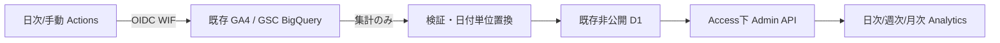

# Analytics v2

読者体験・コンテンツ品質・ブランド価値を優先。収益による記事・広告の自動変更は行わない。

既存D1に分析専用テーブルを追加。小規模サイトの集計を日付ごとにJSONで保持し、source/dateの主キーで冪等に置換する。日別JSONは800KB以下、超過時は明示的に失敗し旧成功値を残す。BQは元データの正本。R2メディアbucketは公開なので分析に使用しない。集計テーブルをBQ側に作る権限も不要。

純粋な日付・URL・集計・比較はapplication、wire validationはcontracts、D1はinfrastructure、BQ/AdSense/CLIはscriptsのadapter、Hono/Reactは入出力。機密値はActionsの各stepに限定。公開サイト・MCP・記事公開経路から切り離す。

ユーザーとsessionは日付をまたいで足せない。期間uniqueは日次値を足さず、別のbounded queryで正確なdistinct数を計算し非公開D1にcacheする。日次の人数は系列として保持。GA4/GSCは日境界が異なり個別ユーザーJOINを行わない。週次/月次workflowはD1からレポートを作り、BQを再走査しない。AIは未設定・無効。認証がないAdSense/未確定ASPも通常集計から独立する。

Adminの最大93日+前期間は186日。D1からは7日ごとに読取り、単一レスポンスに長期間の検索語JSONを詰め込まない。画面出力は上位100行と日次系列だけに限定。日別800KB上限は将来の増大時に再設計が必要となる運用上限であり、無制限の生データ複製を許可するものではない。
